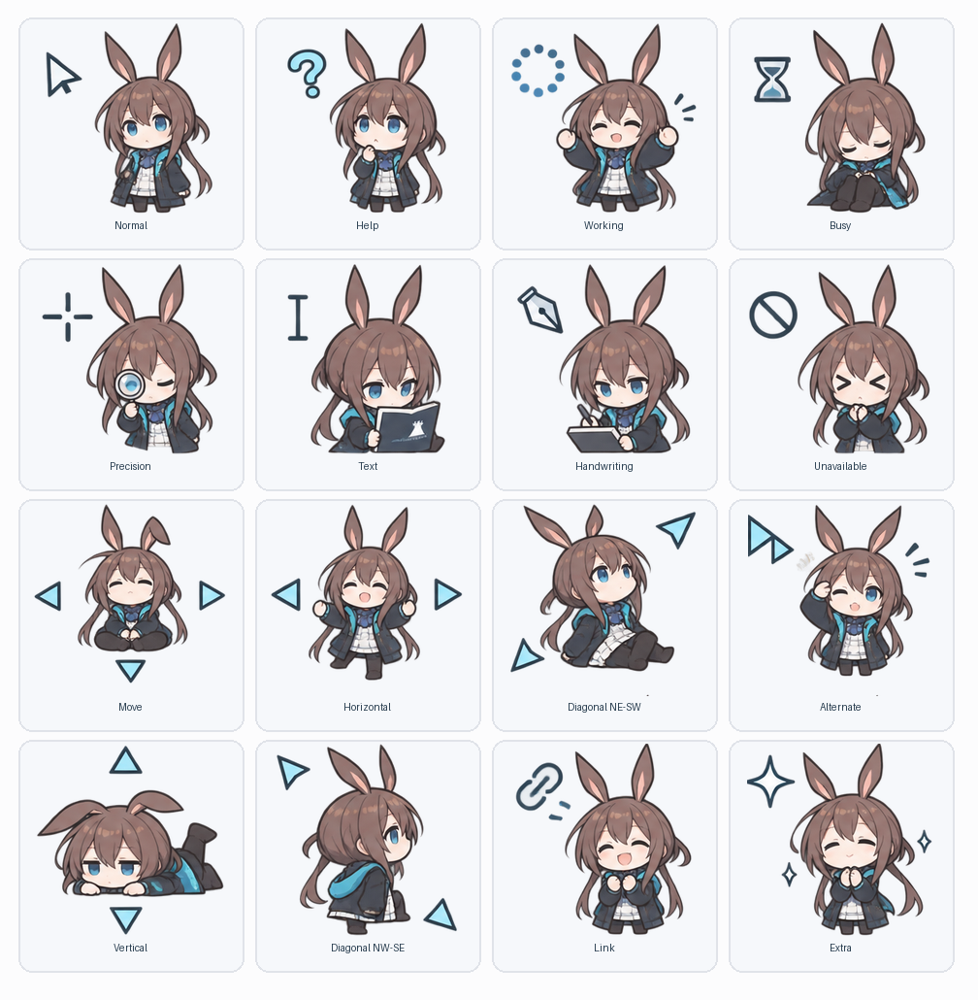

# 阿米娅 Q 版 Windows 鼠标指针主题


[](LICENSE)


一套以《明日方舟》角色阿米娅为主题的 Windows 鼠标指针，采用 Q 版角色设计，适合桌面美化。指针采用透明背景，包含 16 种角色动作，以及等待和后台运行两种动态效果。



## 特点

- 覆盖 Windows 的 17 个指针槽位，包括普通选择、文本选择、链接选择和窗口大小调整。
- 静态指针内含 32、48、64、96、128 像素图像；两个动态指针内含 32、64、96、128 像素图像。
- 安装到当前用户目录，无需管理员权限或常驻程序。
- 提供源图、构建脚本和校验工具，可调整点击热点并重新生成指针。

## 安装

适用于 Windows 10 / 11。使用现成的指针文件无需安装 Python。

1. 下载并解压项目 ZIP，保留解压后的目录结构。
2. 双击 `Install.cmd`，等待安装完成。
3. 如果指针没有立即切换，按 `Win + R`，输入 `control.exe main.cpl,,1`，在「指针」选项卡选择 **Amiya Chibi**，点击「应用」。

安装程序将指针复制到 `%LOCALAPPDATA%\AmiyaCursorPack\cursors\multi\`，并为当前用户注册和应用方案。

系统指针大小和显示缩放会影响实际显示效果。调整 Windows 指针大小后，如有需要，可在「指针」选项卡重新选择该方案。部分角色图案与点击热点相距较远，安装后可以检查常用指针的点击位置。

## 恢复与卸载

| 操作 | 运行文件 | 效果 |
| --- | --- | --- |
| 恢复默认指针 | `Restore.cmd` | 应用 Windows 默认指针，保留阿米娅方案和已安装文件，方便重新启用。 |
| 卸载主题 | `Uninstall.cmd` | 应用 Windows 默认指针，移除本包注册的方案和复制的指针文件。 |

恢复与卸载均直接应用 Windows 默认指针。旧版本留下的备份文件会在运行恢复或卸载时清理。

## 指针状态

| 素材 | Windows 指针槽位 |
| --- | --- |
| Normal | Arrow（普通选择） |
| Help | Help（帮助选择） |
| Working | AppStarting（后台运行，动态） |
| Busy | Wait（忙，动态） |
| Precision | Crosshair（精确选择） |
| Text | IBeam（文本选择） |
| Handwriting | NWPen（手写） |
| Unavailable | No（不可用） |
| Move | SizeAll（移动） |
| Horizontal | SizeWE（水平调整） |
| Diagonal NE-SW | SizeNESW（对角调整） |
| Alternate | UpArrow（候选选择） |
| Vertical | SizeNS（垂直调整） |
| Diagonal NW-SE | SizeNWSE（对角调整） |
| Link | Hand（链接选择） |
| Extra | Pin、Person（位置选择、人员选择） |

Pin 和 Person 共用 Extra 的角色动作。两个动态指针由静态素材生成轻微的上下浮动效果。

## 项目文件

```text
├── Install.cmd / Restore.cmd / Uninstall.cmd  # 安装、恢复与卸载入口
├── preview.png                                # 16 种素材预览
├── assets/source_atlas.png                    # 角色源素材
├── png/                                       # 切分后的透明素材
├── cursors/multi/                             # 安装使用的多分辨率 CUR 和 ANI
├── cursors/64/、96/、128/                     # 旧版单分辨率素材
├── scripts/                                   # 安装与恢复 PowerShell 脚本
├── tools/build.py                             # 素材与指针生成
├── tools/validate.py                          # 格式与加载校验
└── requirements.txt                           # 构建依赖
```

## 素材与许可

本项目是以《明日方舟》角色阿米娅为主题的非官方同人作品。项目中由创作者有权授权的内容采用 [知识共享署名 4.0 国际许可协议（CC BY 4.0）](LICENSE)，允许在署名并遵守协议条款的前提下使用、分享和改编，包括商业用途。角色及《明日方舟》相关权利归其权利人所有。

## 技术参考

- [Microsoft：About Cursors](https://learn.microsoft.com/windows/win32/menurc/about-cursors)
- [Microsoft：Windows Theme File Format](https://learn.microsoft.com/windows/win32/controls/themesfileformat-overview)
- [Windows CUR 格式说明](https://github.com/notfeylo/cursed/blob/main/docs/CURSOR_FORMAT.md)
- [ANI（RIFF/ACON）格式](https://www.daubnet.com/en/file-format-ani)

## 生日祝福

这份阿米娅指针主题是送给 **虾酱不吃鱼** 的生日礼物。

愿你新的一岁常有欢喜，所遇皆美好。**生日快乐！** 🎂


